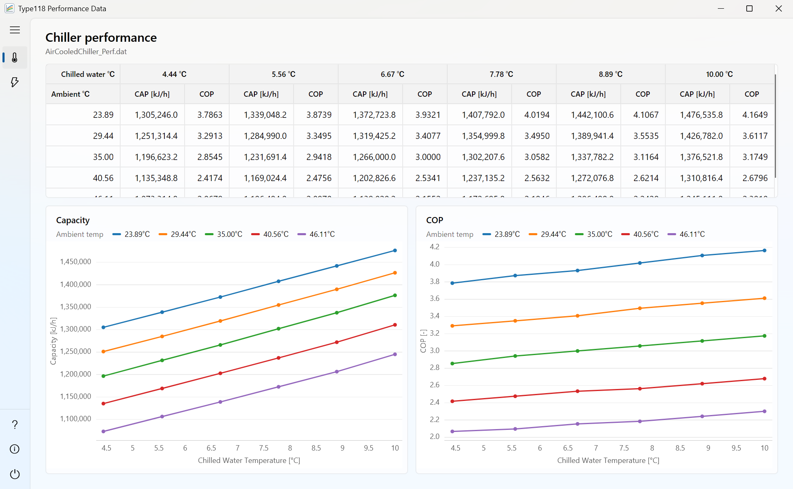

# Type118 Performance Data

[日本語](README.md) | English

Type118 Performance Data is a plug-in for TRNSYS Simulation Studio. It lets you view and edit the performance data files used by Type118, the air-cooled chiller component, as tables and charts.

This repository hosts the installer for the plug-in.

## Overview

Type118 (Air-Cooled Chiller) reads the chiller's performance from two external files (performance data files). These are text files filled with numbers, so it is hard to picture the chiller's performance by opening them in a text editor.

The plug-in starts from the component in Simulation Studio and shows the contents of the performance data files as tables and charts. When you change a value in a table, the chart updates right away, which makes input mistakes easy to spot.

| Performance data file | Contents | Example |
|---|---|---|
| Chiller performance data | Capacity [kJ/h] and COP for each combination of chilled water temperature and ambient (dry-bulb) temperature | `AirCooledChiller_Perf.dat` |
| Part-load performance data | Fraction of full load power for each part-load ratio (PLR) | `AirCooledChiller_PLR.dat` |

## Features

- Shows the chiller performance data and the part-load performance data as tables and charts
- Values can be edited in the table cells, and the charts update immediately
- A cell is outlined in red when you enter a value that is not a number
- When you choose to save on exit, the plug-in rewrites the performance data files and updates the component's parameters (No. 4 to 6) to match the number of data points
- Warns you before saving if the ambient temperatures or part-load ratios are not in ascending order

## Requirements

- TRNSYS 18 (64-bit)
- Windows 10 / 11 (64-bit)

## Installation

1. Download the installer (`Type118-Performance-Data-Setup-x.x.x.x.exe`) from [Releases](https://github.com/TRNSYSJP/type118-performance-data/releases)
2. Run the installer and follow the instructions. Select the TRNSYS 18 folder (usually `C:\TRNSYS18`) as the destination

Notes:

- The installer is not code-signed, so Windows SmartScreen may show a warning ("Windows protected your PC"). If it does, click "More info" and then "Run anyway"
- Administrator rights are required
- If an earlier version (1.0.0 or 2.0.0) is installed, just run the installer as it is

To uninstall, open Windows "Settings" > "Apps" > "Installed apps" and uninstall "TRNSYS Type118 Performance Data Plug-in".

## Usage

1. In the Direct Access Toolbar of Simulation Studio, place `Type118+plugin` from "HVAC" > "Air-Cooled Chiller" in your project
2. Double-click the component to open its window, and specify the two performance data files on the "External Files" tab
3. Select the "Parameter" tab and click the magic stick button at the bottom left to open the plug-in
4. Edit the values, and choose Save when you exit to save them to the performance data files

The default files are the TRNSYS 18 samples (`Examples\Sample Catalog Files`). To avoid overwriting the samples, copy the files to your project folder or another location and specify the copies.

For details, see the manual installed with the plug-in (Japanese and English). You can open it from Help in the plug-in's menu (or with the F1 key).

## Related information

- [Type118 Performance Data Plugin (blog post, in Japanese)](https://www.kankyoukei.com/2021/08/type118-performance-data.html): an introduction to the plug-in, with a video of it in action

## Release notes

| Version | Changes |
|---|---|
| 2.1.0 | Added the manual (Japanese and English). The manual can be opened from the plug-in and the installer. Changed the folder the plug-in is installed in |
| 2.0.0 | Rebuilt the plug-in (Windows 11 design). .NET Framework is no longer required. Added input validation and a warning before saving. Changed the installer |
| 1.0.0 | First release |

---

Copyright © 2021-2026 quattro corporate design. All rights reserved.
