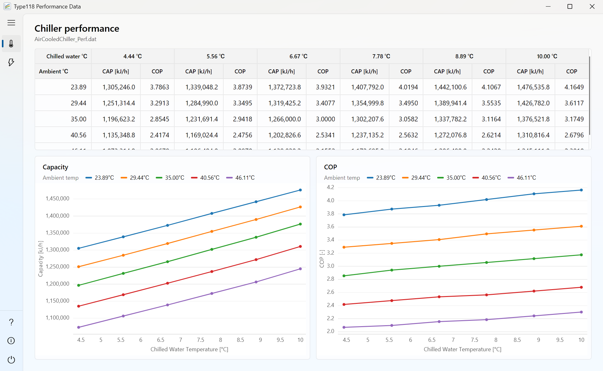

# Type118 Performance Data

日本語 | [English](README.en.md)

Type118 Performance Data は、TRNSYS Simulation Studio 用のプラグインです。空冷チラーのコンポーネント Type118 が参照する性能データファイルを、表とグラフで確認・編集できます。

このリポジトリでは、プラグインのインストーラーを公開しています。

## 概要

Type118（Air-Cooled Chiller）は、チラーの性能を 2 つの外部ファイル（性能データファイル）から読み込んで計算します。性能データファイルは数値が並んだテキスト ファイルで、テキスト エディターで開いても、チラーの性能を読み取るのは簡単ではありません。

このプラグインは、Simulation Studio のコンポーネントから起動して、性能データファイルの内容を表とグラフで表示します。表の値を書き換えるとグラフにすぐ反映されるので、入力の誤りにも気付きやすくなります。

| 性能データファイル | 内容 | 例 |
|---|---|---|
| チラー性能データ | 冷水温度・外気温（乾球温度）ごとの能力（Capacity [kJ/h]）と COP | `AirCooledChiller_Perf.dat` |
| 部分負荷性能データ | 部分負荷率（PLR）ごとの全負荷電力比（Fraction of full load power） | `AirCooledChiller_PLR.dat` |

## 主な機能

- チラー性能データと部分負荷性能データを、表とグラフで表示します
- 表のセルで値を編集できます。編集した値は、グラフにすぐ反映されます
- 数値でない値を入力すると、セルの枠を赤くして知らせます
- 終了するときに保存を選ぶと、性能データファイルを書き換え、データの数に合わせてコンポーネントのパラメーター（No.4〜6）を更新します
- 外気温や部分負荷率が昇順でない場合は、保存する前に警告します

## 動作環境

- TRNSYS 18（64 ビット）
- Windows 10 / 11（64 ビット）

## インストール

1. [Releases](https://github.com/TRNSYSJP/type118-performance-data/releases) から、インストーラー（`Type118-Performance-Data-Setup-x.x.x.x.exe`）をダウンロードします
2. インストーラーを実行して、画面の指示に従ってインストールします。インストール先には TRNSYS 18 のフォルダ（通常は `C:\TRNSYS18`）を指定します

注意点は次のとおりです。

- インストーラーはコード署名していないため、Windows SmartScreen の警告（「Windows によって PC が保護されました」）が表示されることがあります。その場合は「詳細情報」をクリックしてから「実行」をクリックしてください
- インストールには管理者の権限が必要です
- 以前のバージョン（1.0.0、2.0.0）がインストールされている場合も、そのままインストーラーを実行してください

アンインストールは、Windows の「設定」→「アプリ」→「インストールされているアプリ」で、「TRNSYS Type118 Performance Data Plug-in」を選んで行います。

## 使い方

1. Simulation Studio の Direct Access Toolbar で、「HVAC」→「Air-Cooled Chiller」にある `Type118+plugin` をプロジェクトに配置します
2. コンポーネントをダブルクリックしてウィンドウを開き、「External Files」のタブで 2 つの性能データファイルを指定します
3. 「Parameter」のタブを選び、左下のマジックスティックのボタンをクリックすると、プラグインが開きます
4. 値を編集し、終了するときに Save を選ぶと、性能データファイルに保存されます

既定のファイルは TRNSYS 18 のサンプル（`Examples\Sample Catalog Files`）です。サンプルを書き換えないように、ファイルをプロジェクトのフォルダなどにコピーしてから指定してください。

詳しい使い方は、インストールされるマニュアル（日本語・英語）をご覧ください。マニュアルは、プラグインのメニューの Help（F1 キー）から開けます。

## 関連情報

- [Type118 Performance Data Plugin（建築環境工学系日記）](https://www.kankyoukei.com/2021/08/type118-performance-data.html): プラグインの紹介と、動作している様子の動画

## リリース情報

| バージョン | 変更内容 |
|---|---|
| 2.1.0 | マニュアル（日本語・英語）を追加。プラグインとインストーラーからマニュアルを開けるようにした。プラグインのインストール先を変更 |
| 2.0.0 | プラグインを作り直した（Windows 11 のデザイン）。.NET Framework が不要になった。入力の確認、保存の前の警告を追加。インストーラーを変更 |
| 1.0.0 | 最初のリリース |

---

Copyright © 2021-2026 quattro corporate design. All rights reserved.
